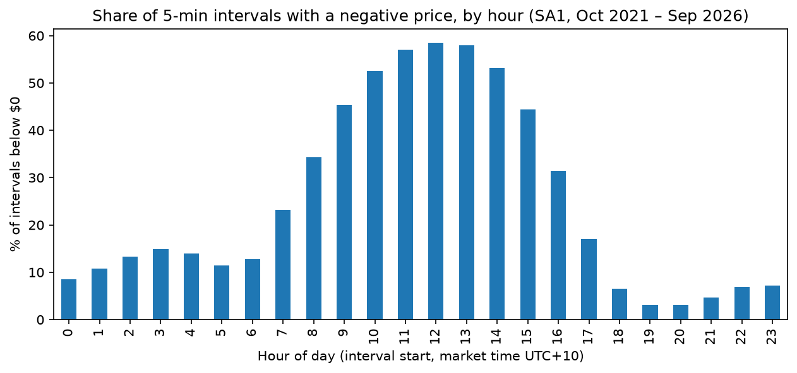
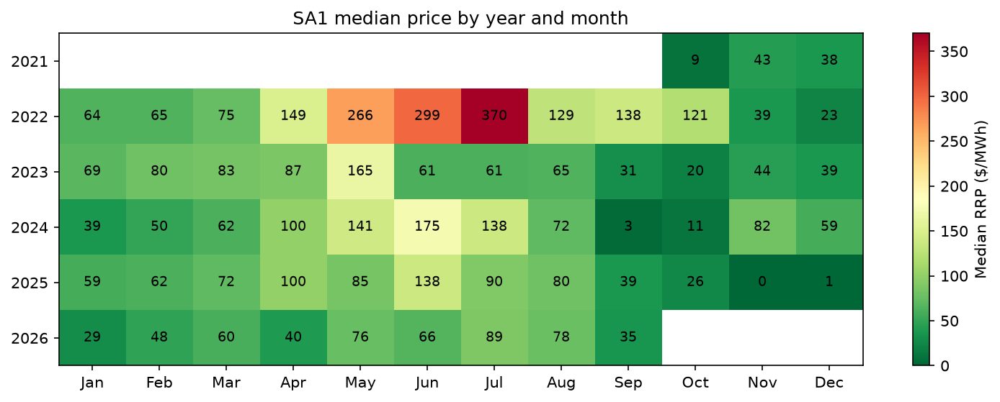
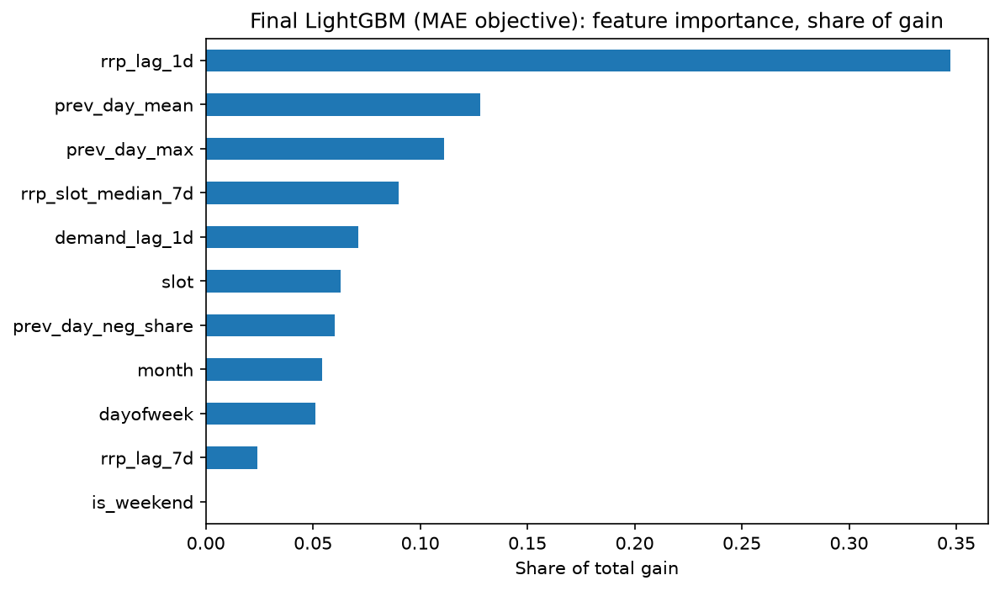
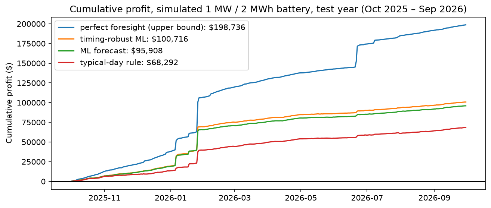

<!-- Source: README.md and src/nem_battery/battery.py in the GitHub repo. Keep the numbers in sync if they change. -->

## Overview

A LightGBM forecast combined with a timing-robust linear-programming optimiser earned **$100,716** for a simulated 1 MW / 2 MWh battery over the held-out test year (Oct 2025 – Sep 2026): **47.5% more** than a typical-day rule ($68,292), with a smaller worst day (−$241 vs −$924) and fewer losing days (11.8% vs 17.5%).

The [interactive dashboard](https://nem-battery-trading-sa-adl.streamlit.app/) lets you compare strategies and replay any day of the test year, half-hour by half-hour.

## The problem

South Australia has one of the most volatile wholesale electricity markets in the world, driven by very high wind and rooftop solar. A battery can earn money through **arbitrage**: charge when prices are low (often negative at midday) and discharge when they're high (the evening peak).

But future prices are uncertain, the battery has physical limits, and a wrong decision costs money. So the question was:

> Can probabilistic forecasting and optimisation help a battery operator make better trading decisions than simple rules?

## The data

| | |
|---|---|
| Source | Australian Energy Market Operator (AEMO), aggregated price and demand data |
| Region | South Australia (`SA1`) |
| Period | October 2021 – September 2026, all under 5-minute settlement |
| Size | 525,888 five-minute intervals |
| Quality | 0 duplicates, 0 missing intervals, constant 5-minute spacing |

Extreme values (negative prices, the −$1,000 floor, the $20,300 cap, even negative demand) were **kept**: they're real market events, and they matter most for a battery.

## What the data shows

- **Prices are heavily skewed:** median $67.58/MWh, mean $98.74/MWh, ranging from the −$1,000 market floor to the $20,300 cap.
- **Negative prices are common:** 24.7% of all intervals, and more than half of midday intervals (10:00–14:00), versus about 3% in the evening peak. This daily cycle is the arbitrage opportunity.
- **Grid demand can be negative:** down to −311 MW on Christmas Day 2025, when rooftop solar exceeded all of South Australia's consumption.
- **The market keeps changing:** the 2022 energy crisis created a very different price regime, and spring prices have fallen towards zero over time.

## Approach

**Forecast setup.** At midnight (market time), forecast all 48 half-hourly prices of the next day. Every feature is known at midnight, which rules out leakage by design.

**Features.** Calendar (half-hour of day, weekday, month), lags (same half-hour yesterday and last week), a 7-day same-slot median, and previous-day summaries (mean, maximum, share of negative prices, demand).

**Validation.** A chronological split, never random:

| Set | Period | Use |
|---|---|---|
| Train | Oct 2021 – Sep 2024 | Model fitting |
| Validation | Oct 2024 – Sep 2025 | Model and strategy selection |
| Test | Oct 2025 – Sep 2026 | Final evaluation, run once |

**Models.** Naive and seasonal baselines → linear regression (OLS, Huber) → LightGBM → quantile LightGBM (10th/50th/90th percentiles) → a LightGBM spike classifier (price > $300).

**Battery optimisation.** Each day, a linear program (SciPy `linprog` with the HiGHS solver) chooses how much to charge $$c_t$$ and discharge $$d_t$$ in each half-hour $$t$$, given the forecast prices $$\hat{p}_t$$:

$$
\max_{c,\,d}\; \sum_{t=1}^{48} \Big( \hat{p}_t\,(d_t - c_t) - \kappa\, d_t \Big)\,\Delta t
$$

subject to the battery's physics:

$$
s_t = s_{t-1} + \eta\, c_t\,\Delta t - \frac{d_t\,\Delta t}{\eta},
\qquad 0 \le c_t,\, d_t \le 1\ \text{MW},
\qquad 0 \le s_t \le 2\ \text{MWh},
\qquad s_0 = s_{48} = 0
$$

where $$s_t$$ is the stored energy, $$\Delta t = 0.5$$ h, $$\eta = \sqrt{0.9}$$ (90% round-trip efficiency, losses split between charging and discharging) and $$\kappa$$ = $10/MWh is the degradation cost. The schedule is planned from **forecasts** at midnight, then paid at **actual** prices.

## Results

### Forecast accuracy (test year)

| Model | MAE ($/MWh) | RMSE ($/MWh) |
|---|---|---|
| **LightGBM** | **58.11** | 415.52 |
| 7-day same-slot median (best baseline) | 65.62 | 420.06 |
| Global median | 75.43 | 420.52 |

LightGBM is 11.4% more accurate than the best baseline (9.4% on validation, so the gain held up). RMSE barely improves: extreme spikes remain essentially unpredictable from day-ahead information.

### Uncertainty (validation year)

- **Spike model (price > $300):** ROC AUC 0.874, Brier skill score 0.157. It ranks risky half-hours well, but overestimates risk in its highest-risk group (about 17% predicted vs 9.5% observed).
- **80% prediction intervals** covered only 68.4% of actual prices, so they were overconfident, especially overnight (about 62%).

### Business value (test year)

| Strategy | Total profit | Share of perfect foresight | Worst day | Losing days |
|---|---|---|---|---|
| Perfect foresight (upper bound) | $198,736 | 100% | +$8 | 0% |
| **Timing-robust ML** | **$100,716** | **50.7%** | −$241 | **11.8%** |
| ML forecast | $95,908 | 48.3% | −$210 | 13.2% |
| Typical-day rule | $68,292 | 34.4% | −$924 | 17.5% |

**Reading the result honestly:**

- The timing-robust ML strategy beat the typical-day rule in **8 of 12** test months; the four losing months were all within $164.
- **January 2026 accounts for 73% of the advantage** (a month with a price-cap event). Excluding it, ML still earned **20.6% more** over the other 11 months.
- The typical-day rule's capture fell from 55.7% on validation to 34.4% on test: a fixed historical pattern degrades as the market changes, while forecasts adapt.

## Key lessons

1. **Median for accuracy, mean for decisions.** An MAE-optimal forecast predicts the median, which undervalues spike-prone evenings.
2. **Timing matters more than level.** On 1 February 2025, a forecast-driven battery planned its discharge about an hour too late and missed a $15,900/MWh spike. Smoothing the forecast over ±30 minutes spreads that risk: this is the "timing-robust" strategy.
3. **Aggregates hide what matters.** 10 days (2.7% of the validation year) caused 26% of forecast error, and single days could swing strategy rankings by $10,000.
4. **Test ideas, keep the honest ones.** A spike-probability adjustment was tried and rejected; it added almost nothing.

## Limitations

- A simplified battery: daily planning, starting and ending empty, no cycle limits beyond a degradation cost.
- The battery is a **price-taker**: its trades don't affect market prices.
- Day-ahead planning only; real batteries re-optimise continuously and also earn from ancillary (FCAS) markets.
- No network charges, bidding rules or regulatory detail.
- Results are **simulated** on historical data, not real trading performance.

## Next steps

- Weather and wind generation features (for night-time negative prices and heat-driven spikes)
- Conformal calibration of the prediction intervals, verified on the test year
- Intraday re-optimisation as new prices arrive
- Scenario-based or stochastic optimisation using full price distributions

<small>Data © AEMO, used under the AEMO Copyright Permissions Notice.</small>
